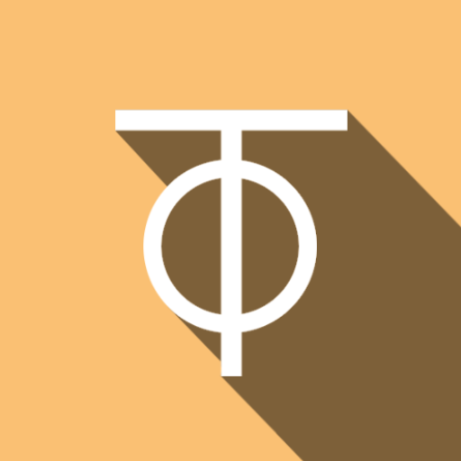
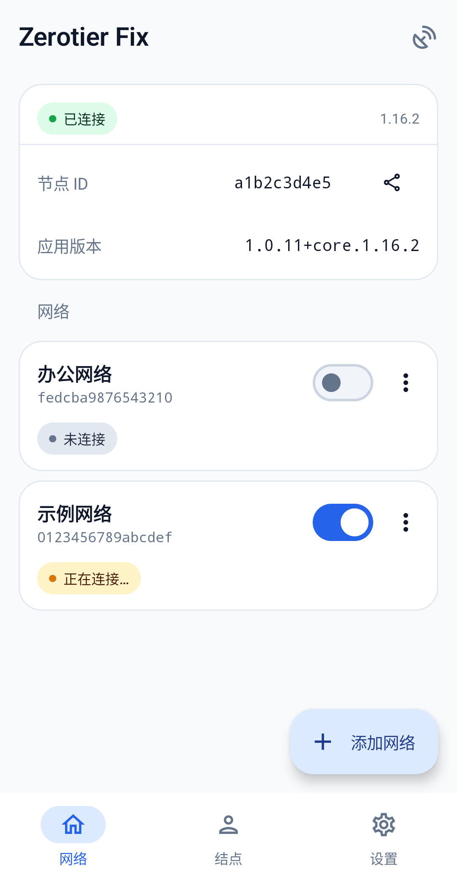
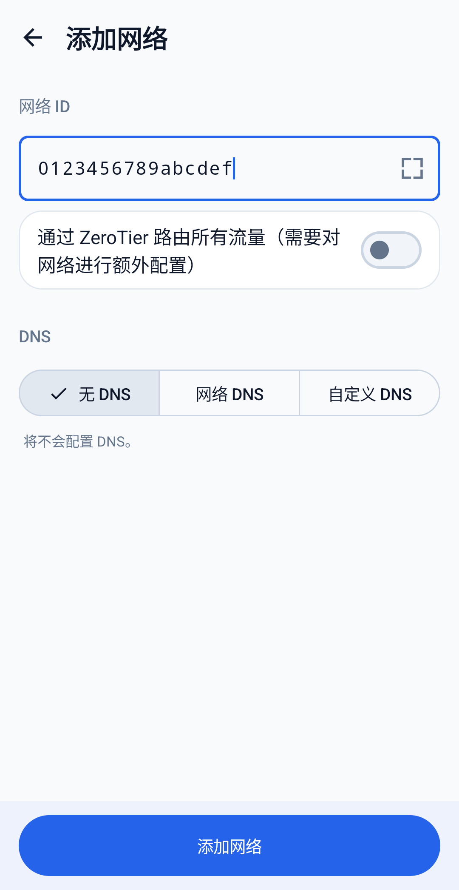
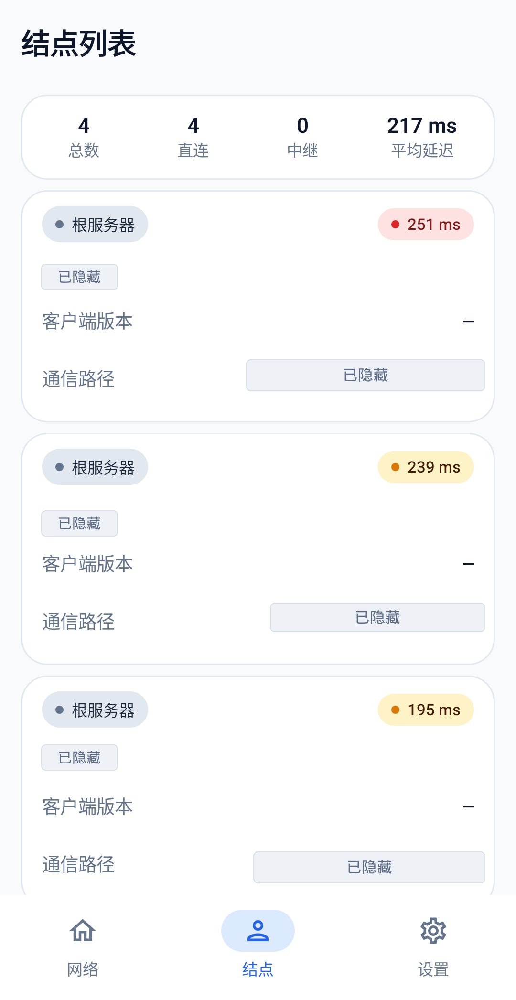
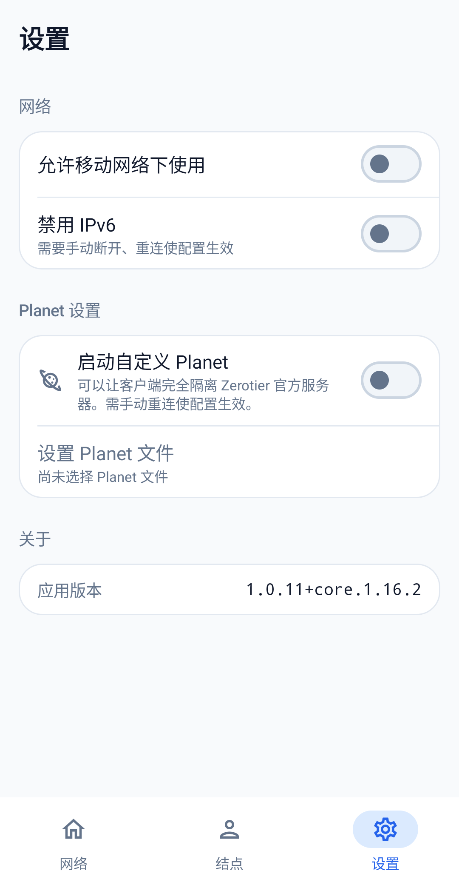
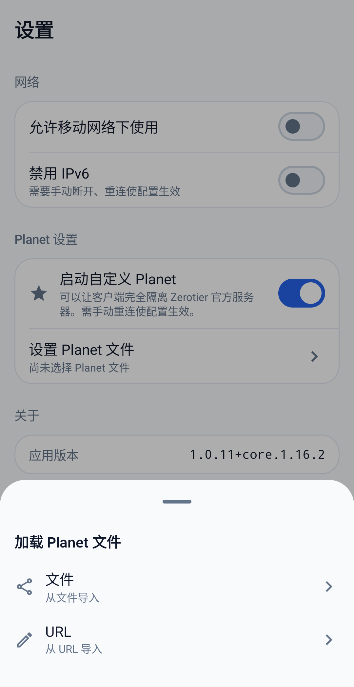

<h1 align="center">

  

   Zerotier Fix 

</h1>

  面向 <b>自建 ztnet / 自建 Planet</b> 用户的现代 ZeroTier Android 客户端

  

  

  

  

  

  

## 简介

Zerotier Fix 是一个第三方的 ZeroTier Android 客户端，界面使用现代 Material 3 设计重新
打造，并补上了官方客户端缺失的自定义 Planet 能力。

如果你使用 [ztnet](https://github.com/sinamics/ztnet) 或其它自建的 ZeroTier 控制器，
并为自己网络生成了独立的 Planet，这个客户端可以让手机直接连上你的私有根服务器，而不再
依赖 ZeroTier 官方 Planet。

## 功能

### 自建 Planet

- 通过本地文件或 URL 导入 planet
- 一键启用 / 关闭自定义 Planet，完全隔离 ZeroTier 官方服务器
- 配置变更后断开重连即可生效

### 网络

- 添加 / 删除网络，支持输入 16 位 Network ID 或扫描二维码
- 每个网络独立开关，可选择通过 ZeroTier 路由全部流量
- DNS 模式：无 DNS / 网络 DNS / 自定义 DNS（IPv4、IPv6）
- 详情页展示状态、托管 IP、MAC、MTU、网络类型与 DNS 等信息

### 结点与 Moon

- 结点列表展示角色（根服务器 / Moon / Leaf）、客户端版本、延迟与直连 / 中继路径
- 汇总结点总数、直连数、中继数与平均延迟
- Moon 入轨：导入 moon 文件，或手动填写 Moon 地址与种子

### 系统集成

- VPN 前台服务与常驻通知，通知中显示当前网络名称
- 快捷设置磁贴一键连接 / 断开
- 移动数据与 IPv6 开关
- 浅色 / 深色主题，宽屏下自动切换为侧边导航栏
- 简体中文与英文界面

## 快速开始（ztnet + 自建 Planet）

1. 在 ztnet 控制台生成并下载你网络的 `planet` 文件，或准备一个可访问的下载链接。
2. 安装 APK 并打开应用。
3. 进入 **设置 → Planet 设置**：
   - 打开 **启动自定义 Planet**；
   - 点击 **设置 Planet 文件**，选择 **文件** 或 **URL** 导入。
4. 回到 **网络** 页，点击 **添加网络**，输入 16 位 Network ID，或扫描 ztnet 提供的加入二维码。
5. 打开网络开关，并按系统提示授予 VPN 权限。
6. 在 ztnet 控制台授权该设备（私有网络需要手动授权）。
7. 如果修改了 Planet 文件，请先关闭再打开网络，使新配置生效。

> 扫码支持 `https://joinzt.com/addnetwork?nwid=<16 位 Network ID>` 形式的链接，也支持
> 直接包含 Network ID 的二维码。

## 下载

- 稳定版：[Releases](https://github.com/flyouter/ZerotierFix/releases)
- 开发版：[Actions](https://github.com/flyouter/ZerotierFix/actions/workflows/build-app.yml)
的构建产物（可能不稳定）

仅支持 64 位 ABI：`arm64-v8a` 与 `x86_64`，同时提供 universal 包。

## 说明与限制

- 本项目是非官方客户端，与 ZeroTier, Inc. 无关联。
- Planet 文件由用户自行提供，应用不内置任何第三方控制器地址。
- Android 同一时间只允许一个 VPN 应用处于活动状态。
- 自定义 Planet 与 Moon 的配置变更需要断开重连后生效。
- 应用不包含统计或追踪 SDK，网络配置与节点身份等数据均保存在本机。

## 版权与致谢

- 上游项目：[kaaass/ZerotierFix](https://github.com/kaaass/ZerotierFix)
- ZeroTier JNI 与核心位于 `externals/core` 子模块。
- 应用图标中的 ZeroTier 标识属于 ZeroTier, Inc.。
- 本项目以 GPLv2 发布，详见 [LICENSE](LICENSE)。